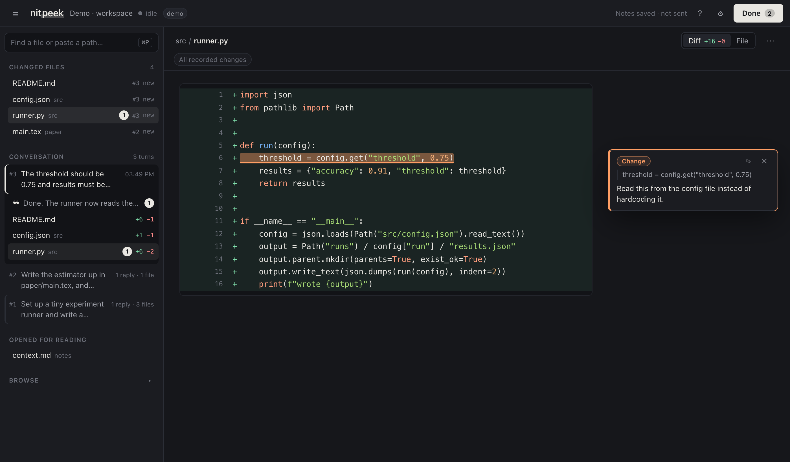

# nitpeek

Review what your coding agent did, the way you would review a pull request. Read its replies, see what it changed, highlight the parts that matter and write a note on each. Then hand all the notes back as one prompt. Nothing is sent until you press Enter.

Works with **Claude Code** (as a hook) and **Pi** (as an extension).



```
/annotate              review this session
/annotate-last         review only the latest reply
/annotate <path>       review a file or folder, even one the agent never touched
```

## What you get

- **Every change, by turn.** Changed files are tagged with the turn that last touched them, and each prompt shows the replies and diffs it produced. "Since last Done" shows only what you have not reviewed yet.
- **Notes with an intent.** Select text or click a line number, then say what you want: *change* it, *reply* to something the agent asked, ask a *question*, or *keep* it as it is.
- **Notes that point at the right place.** Each note quotes the text it is about and gives its location in the file as it is on disk now. If the file changed since, the quote is found again, or the note says it is gone instead of giving a wrong line.
- **Readable documents.** Markdown and LaTeX can be read rendered, with KaTeX math and TikZ figures compiled in the browser, so you can review a paper the same way you review code.

When you press Done, the agent gets something like this:

```
Review notes (2) — reply to each by its number.

[1] reply · your response to "The threshold should be 0.75…"
> Want me to add the validation now?
Yes, and reject values below 0.5.

[2] change · src/runner.py:6
>     threshold = config.get("threshold", 0.75)
Read this from the config file instead of hardcoding it.
```

## Install

```bash
git clone https://github.com/andremmsilva/nitpeek ~/dev/nitpeek
cd ~/dev/nitpeek && bun install && bun run build
```

Setup for Claude Code and Pi, keyboard shortcuts and how it captures edits are in [docs/details.md](docs/details.md).

## Development

```bash
bun run demo       # a demo session at a local URL
bun run test       # all suites, including a headless-Chrome UI test
```

`core/` has the store, feedback format, rendering and server. `ui/` is a Preact app. `hosts/` connects it to each agent. Started as a fork of [pi-annotate](https://github.com/nicobailon/pi-annotate) by Nico Bailon and since rewritten.

## License

MIT. See [LICENSE](LICENSE).
